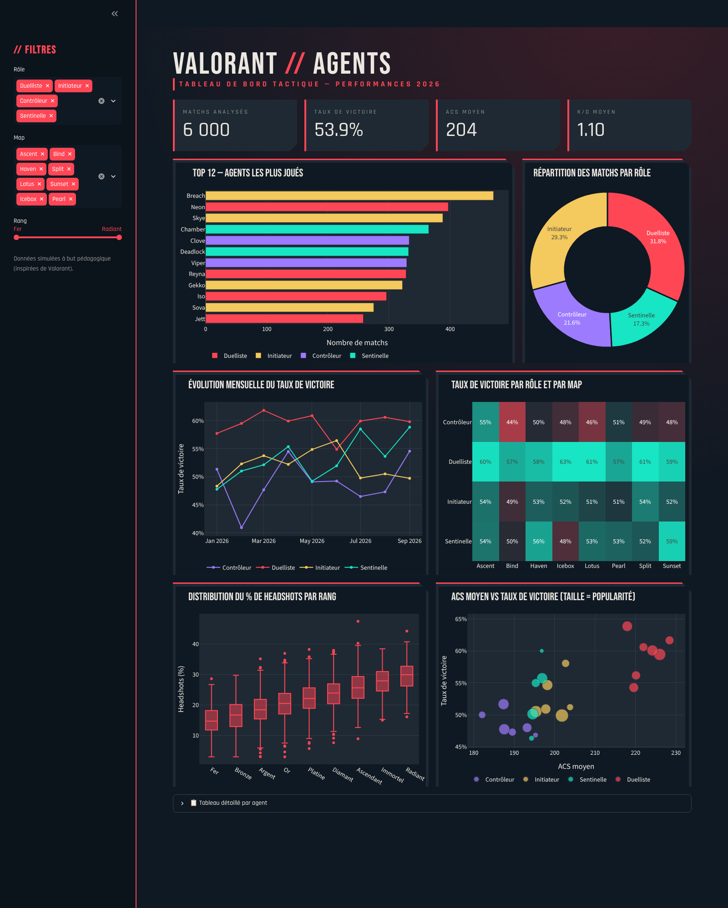

# Dashboard Valorant — Performances des agents

**Projet individuel — Visualisation de données | Thématique : les jeux vidéo**
Adam Morin — BUT Science des Données (VCOD FA)

## Description

Tableau de bord interactif réalisé avec **Streamlit & Python (Plotly)** autour du jeu de tir tactique *Valorant*. Il permet d'analyser les performances des agents (personnages jouables) selon leur **rôle**, la **map** jouée et le **rang** des joueurs.



## Origine des données

Les données sont **simulées**, pas tirées d'une vraie API ou d'un vrai historique de parties. La fonction `load_data()` dans `app.py` génère 6 000 lignes (= 6 000 "matchs" fictifs) :

1. **Les catégories sont réelles** : vrais agents du jeu (Jett, Sova, Omen, Killjoy…), classés dans leurs 4 vrais rôles (Duelliste, Initiateur, Contrôleur, Sentinelle), vraies maps (Ascent, Bind, Haven…) et vrais rangs (Fer → Radiant).
2. **Les valeurs sont tirées aléatoirement** avec `numpy.random`, à partir d'une graine fixe (`seed=42`) : le résultat est donc toujours le même à chaque exécution (reproductible), mais ce ne sont pas de vraies performances de joueurs.
3. **Les tendances sont injectées volontairement**, pour que le jeu de données ait un sens à visualiser : les Duellistes ont un ACS plus élevé que les Contrôleurs, le % de headshots augmente avec le rang, le taux de victoire dépend du K/D, etc.

**Pourquoi des données simulées plutôt qu'une vraie API (Riot Games / tracker.gg) ?** Obtenir et valider une clé d'API, puis adapter le format de ses données, demande du temps que le délai du projet ne permettait pas. L'objectif de l'exercice — mettre en pratique des techniques de visualisation (barres, donut, courbe, heatmap, boxplot, nuage de points) — ne dépend pas de l'authenticité des données sous-jacentes, du moment que c'est annoncé clairement, ce qui est fait ici et dans l'app (message dans la barre latérale).

## Visualisations et choix graphiques

| Objectif | Graphique | Pourquoi ce choix |
|---|---|---|
| Vue d'ensemble | **Cartes KPI** | Lire les chiffres clés en un coup d'œil (matchs, winrate, ACS, K/D) |
| Comparer des catégories | **Barres horizontales** (Top 12 agents) | Noms longs lisibles, classement trié |
| Montrer une composition | **Donut** (rôles) | Peu de catégories (4), part du total |
| Suivre une évolution | **Courbe** (winrate mensuel) | Tendance dans le temps par rôle |
| Croiser deux dimensions | **Heatmap** (rôle × map) | Repérer les combinaisons fortes/faibles par la couleur |
| Décrire une distribution | **Boîte à moustaches** (% headshots par rang) | Médiane, dispersion et valeurs extrêmes |
| Étudier une relation | **Nuage de points / bulles** (ACS vs winrate) | Corrélation + 3e variable (popularité) en taille |

**Identité visuelle** : thème inspiré de l'interface du jeu (fond bleu-nuit `#0F1923`, rouge signature `#FF4655`, typographies condensées *Bebas Neue* / *Rajdhani*, cartes aux coins coupés). Chaque rôle garde la même couleur dans tous les graphiques.

**Interactivité** : filtres par rôle, map et plage de rangs (barre latérale), info-bulles au survol, zoom, tableau détaillé dépliable.

## Lancer le projet

```bash
pip install -r requirements.txt
streamlit run app.py
```

## Fichiers

- `app.py` — code du dashboard
- `requirements.txt` — dépendances
- `.streamlit/config.toml` — thème de couleurs
- `dashboard.png` — capture d'écran du rendu final
